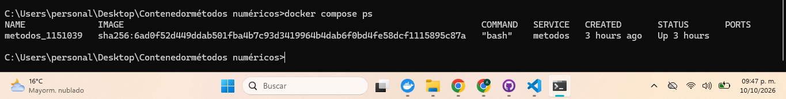
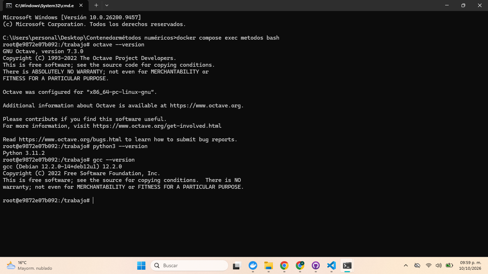
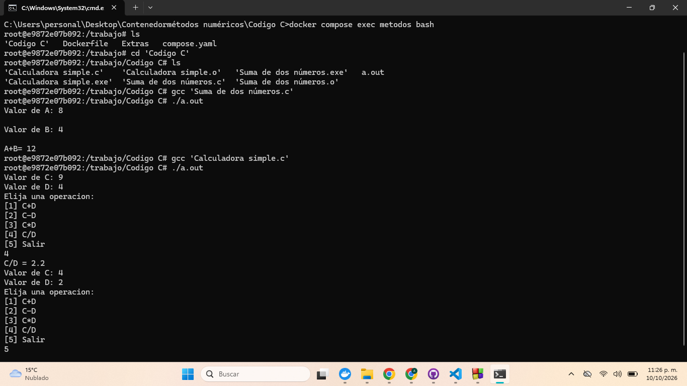

#       Tarea 1 Métodos Númericos
**UEA:** Métodos númericos en ingeniería (1151039)

**Trimestre:** 26-O 

**Licenciatura:** Ingeniería mecánica 

**Alumno:** Zaragoza López Alexander 

**Matricula:** 2173037782

**Profesor:** Gabriel Hurtado Aviles 

**Fecha:** 10 de octubre de 2026

### ¿Qué son los métodos númericos?
Son algoritmos matemáticos usados para calcular resultados de operaciones o ecuaciones que en principio pueden ser muy complejas, estos resultados son aproximaciones al valor real debido a que se obtienen principalmente mediante operaciones aritméticas repetitivas, y por lo tanto, implican una variación en la aproximación respecto a el valor real definida como error. Chapra, S. C., & Canale, R. P. describen en su libro **"Métodos numéricos para ingenieros"** lo siguente: 
>Aunque existen muchos tipos de métodos numéricos, éstos comparten una característica común: invariablemente requieren de un buen número de tediosos cálculos aritméticos. No es raro que con el desarrollo de computadoras digitales eficientes y rápidas, el papel de los métodos numéricos en la solución de problemas en ingeniería haya aumentado de forma considerable en los últimos años. (p. 3)
De lo anterior se puede interpretar que el uso de computo es el más recurrido para trabajar con métodos númericos, debido a la rápidez de cálculo de numerosas operaciones lógicas y repetitivas en comparación a la humana.

### 3. Capturas de entorno contenido
1.- Docker compose up -d --build terminado

2.- Docker compose ps con la columna STATUS en «Up».

3.- Versiones

4.- Docker online

5.- Programas corriendo


### 4. Programas 
1.- Suma de dos números
```
#include<stdio.h>
int main()
{
    int a,b;
    printf("Valor de A: ");
    scanf("%i",&a);
    printf("\nValor de B: ");
    scanf("%i",&b);
    int sum=a+b;
    printf("\nA+B= %.17i\n", sum);
    return 0;
}
```
2.- Calculadora simple
```
#include<stdio.h>
int main()
{
    float c,d;
    int e=0;

    while (e!=5)
    {
        printf("Valor de C: ");
        scanf("%f",&c);
        printf("Valor de D: ");
        scanf("%f",&d);
        printf("Elija una operacion: \n");
        printf("[1] C+D\n");
        printf("[2] C-D\n");
        printf("[3] C*D\n");
        printf("[4] C/D\n");
        printf("[5] Salir\n");
        scanf("%d",&e);
        float sum=c+d,rest=c-d,mult=c*d,div=c/d;
        if (e==1)
        {
            printf("C+D = %.1f\n",sum);
        }
        else if (e==2)
        {
            printf("C-D = %.1f\n",rest);
        }
        else if (e==3)
        {
            printf("C*D = %.1f\n",mult);
        }
        else if (e==4)
        {
            if (d!=0)
            {
                printf("C/D = %.1f\n",div);
            }
            else
            {
                printf("No se puede dividir entre cero\n");
            }
        }
    }
    printf("Calculadora apagada");
}
```