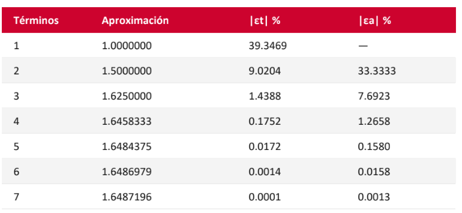
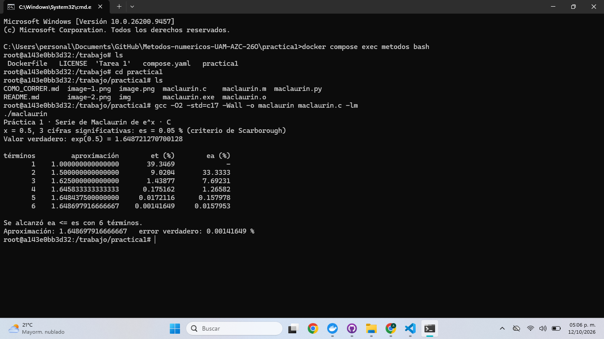

# Práctica 1 · La serie de Maclaurin y el criterio de paro

**UEA 1151039 · Métodos Numéricos en Ingeniería · Trimestre 26-O · UAM Azcapotzalco**
**Profesor:** M. en C. Gabriel Hurtado Avilés

| | |
|---|---|
| Equipo: Trabajo individual| |
| Integrantes: Zaragoza López Alexander, 2173037782, ingeniería mecánica | |
| Repositorio de la Tarea 1 de [Alexaner Zaragoza López](https://github.com/alexzaragozalpz-hash/Metodos-numericos-Alexander-ZL-UAM-AZC-26O)| |
| Fecha: 12 de octubre de 2026| |

## 1. Octave y Python

Compilación en Octave:


Compilación en Python:


Tabla de la lámina 25:



¿Coinciden con la lámina 25 de la unidad I?

Las tablas mostradas por los programas compilados son idénticas pero se observa que sifras significativas en la tabla de la lámina 25 son menores a los presentados por los programas, por lo que se redondean los valores esperados, además, se observa que los programas solo muestran 6 columnas de datos mientras que la lámina muestra una fila extra.

## 2. Las dos líneas que completamos en `maclaurin.c`

```c
/* termino = (termino*X)/n; */
/* ea = fabs((aprox - anterior) / aprox) * 100.0; */
```



## 3. Más cifras significativas

| Cifras | εs (%) | Términos | Aproximación | Error verdadero (%) |
|---|---|---|---|---|
| 3 |0.05|6|1.648697916666667|0.00141649|
| 6 |5e-05|9|1.648721265035962|3.43549e-07|
| 17 |5e-16|16|1.648721270700128|2.69354e-14|

1. ¿Cuántos términos hacen falta en cada caso?

En el caso de 3 cifras significativas hacen falta 6
En el caso de 6 cifras significativas hacen falta 9
En el caso de 17 cifras significativas hacen falta 16

2. En cada fila de la tabla, ¿εa es mayor o menor que εt? ¿Por qué conviene detenerse con εa?

Conviene detenerse utilizando εa porque normalmente no se conoce el valor verdadero de la función en problemas reales. Por ello, se utiliza el error aproximado como criterio para determinar cuándo la solución ha alcanzado la precisión deseada.

3. Con 17 cifras el programa termina. ¿Cuántas cifras del resultado son correctas en realidad?
   Relaciónenlo con 0.1 + 0.2 de la Tarea 1.

Con 17 cifras significativas, el programa indica que el resultado es extremadamente cercano al valor verdadero, aunque no necesariamente todas las 17 cifras significativas son correctas, debido a las limitaciones de precisión de los números de punto flotante de tipo double.
## Uso de inteligencia artificial

Chat GPT, para completar el código en C y responder a las preguntas 2 y 3 del inciso 3

## Referencias

