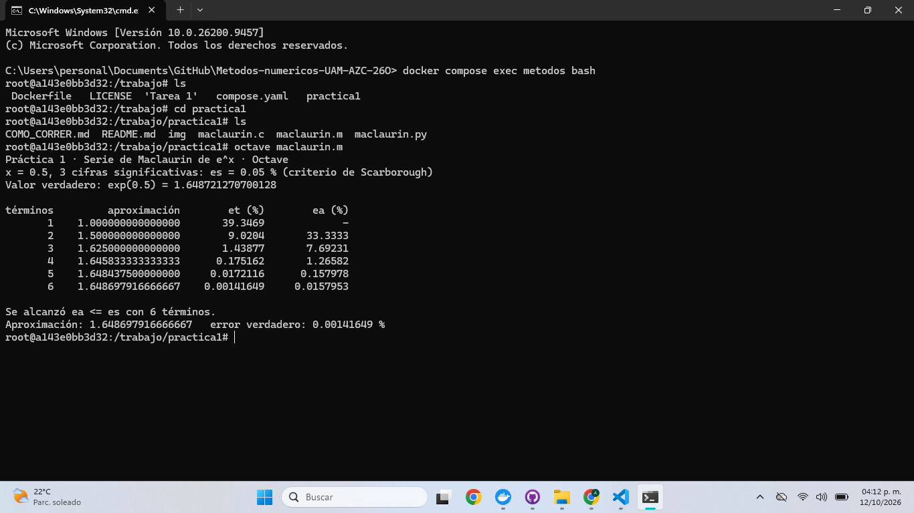
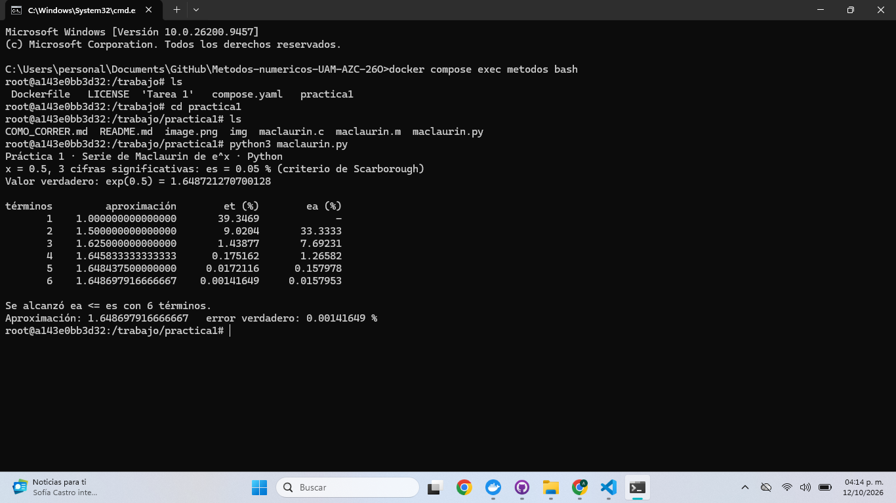

# Práctica 1 · La serie de Maclaurin y el criterio de paro

**UEA 1151039 · Métodos Numéricos en Ingeniería · Trimestre 26-O · UAM Azcapotzalco**
**Profesor:** M. en C. Gabriel Hurtado Avilés

| | |
|---|---|
| Equipo: Trabajo individual| |
| Integrantes: Zaragoza López Alexander, 2173037782, ingeniería mecánica | |
| Repositorio de la Tarea 1 de [Alexaner Zaragoza López](https://github.com/alexzaragozalpz-hash/Metodos-numericos-Alexander-ZL-UAM-AZC-26O)| |
| Fecha: 12 de octubre de 2026| |

## 1. Octave y Python




¿Coinciden con la lámina 25 de la unidad I?

## 2. Las dos líneas que completamos en `maclaurin.c`

```c
/* COMPLETAR 1 */
/* COMPLETAR 2 */
```


## 3. Más cifras significativas

| Cifras | εs (%) | Términos | Aproximación | Error verdadero (%) |
|---|---|---|---|---|
| 3 | | | | |
| 6 | | | | |
| 17 | | | | |

1. ¿Cuántos términos hacen falta en cada caso?
2. En cada fila de la tabla, ¿εa es mayor o menor que εt? ¿Por qué conviene detenerse con εa?
3. Con 17 cifras el programa termina. ¿Cuántas cifras del resultado son correctas en realidad?
   Relaciónenlo con 0.1 + 0.2 de la Tarea 1.

## Uso de inteligencia artificial

Ninguno / Cuál y para qué.

## Referencias

